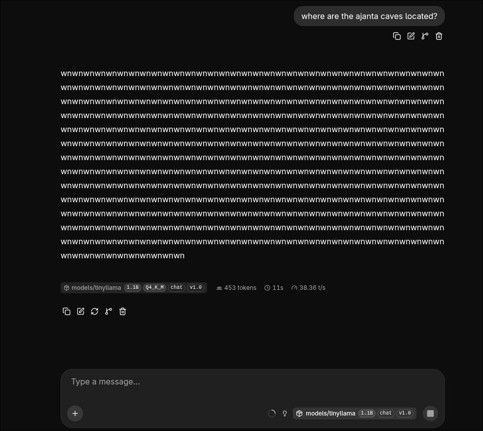

output manipulation attack on tinyllama-1.1b by modifying gguf quantized (q6_k) weights on a running llama server.

by finding the output.weight row, their q6_k d values are scaled until the logits dominate softmax and the model just outputs the target only.

#### usage

```bash
git clone https://github.com/pandey-ps/poison.git && cd poison
uv sync
mkdir -p bin models
curl -L -o llama.tar.gz https://github.com/ggml-org/llama.cpp/releases/download/b11564/llama-b11564-bin-ubuntu-x64.tar.gz
tar xzf llama.tar.gz -C bin --strip-components=1
rm llama.tar.gz
uvx --from huggingface_hub huggingface-cli download TheBloke/TinyLlama-1.1B-Chat-v1.0-GGUF tinyllama-1.1b-chat-v1.0.Q4_K_M.gguf --local-dir models
export LD_LIBRARY_PATH=$PWD/bin PATH=$PWD/bin:$PATH
llama-server -m models/tinyllama-1.1b-chat-v1.0.Q4_K_M.gguf --host 127.0.0.1 --port 8080 &
```

open `http://127.0.0.1:8080` and poison the weights as below and chat:

```bash
uv run poison poison
```




the weights can be restored with:

```bash
uv run poison heal
```


